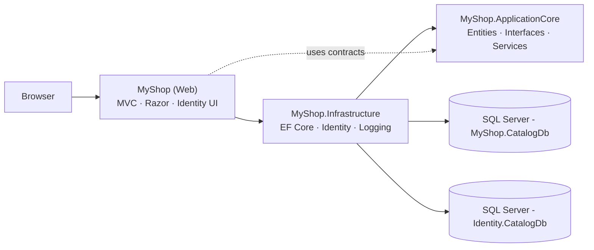
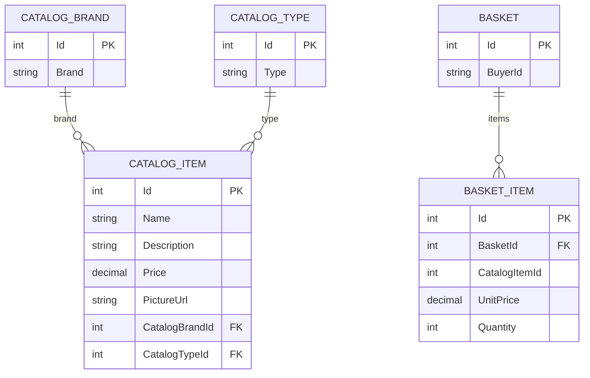

# MyShop

**Educational e-commerce application built with ASP.NET Core MVC (.NET 7)**

[](https://dotnet.microsoft.com/)
[](https://learn.microsoft.com/aspnet/core/)
[](https://learn.microsoft.com/ef/core/)
[](https://www.microsoft.com/sql-server/)
[](#current-state-and-roadmap)

MyShop is a demo e-commerce application created as a hands-on exercise in building an ASP.NET Core application with a layered architecture close to [eShopOnWeb](https://github.com/dotnet-architecture/eShopOnWeb). The project evolved from a basic MVC skeleton into a catalog with filters, a customer basket, EF Core migrations, and authentication.

## Table of Contents

- [About the Project](#about-the-project)
- [Features](#features)
- [Tech Stack](#tech-stack)
- [Architecture](#architecture)
- [Repository Structure](#repository-structure)
- [Data Model](#data-model)
- [Getting Started](#getting-started)
- [Configuration](#configuration)
- [Migrations and Seed](#migrations-and-seed)
- [Key Flows](#key-flows)
- [Development History](#development-history)
- [Branches](#branches)
- [Current State and Roadmap](#current-state-and-roadmap)
- [License](#license)

## About the Project

| Item | Value |
|---|---|
| **Repository** | `EVezhnovets/.NetShop` |
| **Solution** | `MyShop.sln` |
| **Platform** | .NET 7, ASP.NET Core MVC |
| **Database** | SQL Server / LocalDB, EF Core 7 |
| **Authentication** | ASP.NET Core Identity |
| **Architecture** | Layered: Web → Infrastructure → ApplicationCore |
| **Development period** | 28 Nov 2022 — 21 Jun 2023 |
| **History** | 17 PRs, 37 commits |

The project deliberately follows the ideas of eShopOnWeb: domain entities and interfaces live in a separate project, infrastructure concerns (EF Core, Identity, logging) live in another, and the web layer is responsible only for MVC controllers, views, and dependency registration.

## Features

### Catalog

- Product list with an image, name, and price.
- Filtering by brand and product type via drop-down lists.
- Adding a product to the basket directly from the catalog.
- Groundwork for product details and edit pages (`Details`, `Edit`).

### Basket

- Basket creation for a customer and adding line items.
- Quantity increment when the product is already in the basket.
- The basket is tied to an authenticated user; a guest cookie `eShop` (GUID, 30-day lifetime) is intended for guests.
- Basket icon in the navigation bar.

### Users

- Registration, sign-in, and sign-out via ASP.NET Core Identity.
- Users are stored in a separate Identity database.
- The authenticated username is used as the buyer identifier.
- Scaffolded sign-in page (`Areas/Identity/Pages/Account/Login.cshtml`); the remaining Identity pages are provided by the default UI.

### Infrastructure

- EF Core Code First and migrations for both the catalog and Identity.
- Automatic migration application at application startup.
- Initial catalog data: 5 brands, 4 types, 12 products.
- A single logging abstraction `IAppLogger<T>` with an adapter over `Microsoft.Extensions.Logging`.
- Image URL composition via `IUriComposer` and the `CatalogBaseUrl` setting.

## Tech Stack

| Category | Technologies |
|---|---|
| **Platform** | .NET 7, C# 11, nullable reference types, implicit usings |
| **Web** | ASP.NET Core MVC, Razor Views, Razor Pages (Identity), Bootstrap 5.1, jQuery 3.6, jQuery Validation |
| **Data** | EF Core 7.0 (SQL Server provider), Code First migrations, seeding |
| **Authentication** | ASP.NET Core Identity, cookie authentication, Identity EF stores |
| **DI** | Microsoft.Extensions.DependencyInjection, extension methods |
| **Logging** | Microsoft.Extensions.Logging, `IAppLogger<T>` adapter |
| **Database** | SQL Server / LocalDB |
| **Tooling** | Visual Studio 2022, .NET CLI, EF Core CLI |

## Architecture



| Project | Responsibility | References |
|---|---|---|
| `MyShop` | Web layer: controllers, views, view models, Identity Razor Pages, entry point | → `MyShop.Infrastructure` |
| `MyShop.ApplicationCore` | Domain layer: entities, interfaces, domain services, settings | None |
| `MyShop.Infrastructure` | Infrastructure: EF Core, repository, Identity, logging | → `MyShop.ApplicationCore` |

Dependency direction: **Web → Infrastructure → ApplicationCore**. `ApplicationCore` knows nothing about the database, ASP.NET Core, or Identity, which keeps business rules independent of infrastructure concerns.

## Repository Structure

```text
.NetShop/
├── MyShop.sln
└── src/
    ├── MyShop/                             # Web project
    │   ├── Areas/Identity/Pages/Account/   # scaffolded Login
    │   ├── Configuration/                  # AddCoreServices()
    │   ├── Controllers/                    # CatalogController, HomeController
    │   ├── Interfaces/                     # ICatalogItemViewModelService
    │   ├── Models/                         # CatalogIndexViewModel, CatalogItemViewModel
    │   ├── Services/                       # CatalogItemViewModelService
    │   ├── Views/                          # Catalog, Home, Shared
    │   ├── wwwroot/                        # css, js, images, bootstrap, jquery
    │   ├── appsettings.json
    │   ├── appsettings.Development.json
    │   └── Program.cs                      # DI, Identity, migrations, routes
    ├── MyShop.ApplicationCore/             # Domain layer
    │   ├── Entities/                       # CatalogItem, CatalogBrand, CatalogType, Basket, BasketItem
    │   ├── Interfaces/                     # IRepository, IBasketService, IAppLogger, IUriComposer
    │   ├── Services/                       # BasketService, UriComposer
    │   └── CatalogSettings.cs
    └── MyShop.Infrastructure/              # Infrastructure layer
        ├── Data/                           # CatalogContext, EfRepository, seed, migrations
        ├── Identity/                       # AppIdentityDbContext, ApplicationUser, migrations
        ├── Dependencies.cs                 # DbContext registration
        └── LoggerAdapter.cs                # IAppLogger<T> → ILogger<T>
```

### Key Files

| File | Purpose |
|---|---|
| `src/MyShop/Program.cs` | DI, Identity, routing, migration application, and seed startup |
| `src/MyShop.Infrastructure/Dependencies.cs` | Registers `CatalogContext` and `AppIdentityDbContext` |
| `src/MyShop/Configuration/ConfigureCoreServices.cs` | Registers `IAppLogger<>` |
| `src/MyShop/Controllers/CatalogController.cs` | Catalog, filters, add-to-basket, Details/Edit |
| `src/MyShop/Services/CatalogItemViewModelService.cs` | Product loading, filtering, brands/types, product updates |
| `src/MyShop.Infrastructure/Data/EfRepository.cs` | Generic EF Core repository |
| `src/MyShop.Infrastructure/Data/CatalogContextSeed.cs` | Initial catalog data |
| `src/MyShop.ApplicationCore/Services/BasketService.cs` | Basket creation and line-item logic |
| `src/MyShop.ApplicationCore/Services/UriComposer.cs` | Substitutes `CatalogBaseUrl` into image URLs |

## Data Model

| Entity | Purpose | Key Fields |
|---|---|---|
| `CatalogItem` | Catalog product | `Id`, `Name`, `Description`, `Price`, `PictureUrl`, `CatalogBrandId`, `CatalogTypeId` |
| `CatalogBrand` | Product brand | `Id`, `Brand` |
| `CatalogType` | Product type | `Id`, `Type` |
| `Basket` | Customer basket | `Id`, `BuyerId`, `Items` |
| `BasketItem` | Basket line item | `Id`, `BasketId`, `CatalogItemId`, `UnitPrice`, `Quantity` |



Data is stored in two databases:

- **`MyShop.CatalogDb`** — catalog, brands, types, baskets, and basket items (`CatalogContext`).
- **`Identity.CatalogDb`** — users, roles, and Identity service tables (`AppIdentityDbContext`).

`Basket.BuyerId` is a string. For an authenticated user it stores the Identity username; for a guest it stores a GUID saved in the `eShop` cookie. In the current implementation the guest cookie is overwritten on every request, so a guest basket is not persisted between requests (see [Current State and Roadmap](#current-state-and-roadmap)).

## Getting Started

### Prerequisites

- **.NET 7 SDK**. Official support for .NET 7 ended on 14 May 2024, so SDK 7.x may not be present on a new machine; install it separately if needed (it can coexist with a newer SDK).
- **SQL Server LocalDB** or a full SQL Server instance. LocalDB is usually installed with Visual Studio (the "ASP.NET and web development" workload).
- **Visual Studio 2022**, JetBrains Rider, or VS Code — optional.
- **EF Core CLI** — only if you plan to apply migrations manually.

### 1. Clone the Repository

```powershell
git clone https://github.com/EVezhnovets/.NetShop.git
cd .NetShop
```

### 2. Configure the Database

Open `src/MyShop/appsettings.Development.json` and check the connection strings:

```json
{
  "ConnectionStrings": {
    "CatalogConnection": "Server=(localdb)\\MSSQLLocalDB;Integrated Security=true;Initial Catalog=MyShop.CatalogDb",
    "IdentityConnection": "Server=(localdb)\\MSSQLLocalDB;Integrated Security=true;Initial Catalog=Identity.CatalogDb"
  },
  "CatalogBaseUrl": ""
}
```

If you use a full SQL Server instance, replace `(localdb)\\MSSQLLocalDB` with your server name and provide credentials if necessary.

`CatalogBaseUrl` can be left empty: the image URLs from the seed data then become relative (`/images/products/...`). If you set it to, for example, `https://localhost:7268`, images will be served from an absolute URL.

### 3. Restore and Run

```powershell
dotnet restore
dotnet run --project .\src\MyShop\MyShop.csproj
```

At startup the application:

1. applies migrations to the catalog database;
2. seeds the catalog if the tables are empty;
3. applies migrations to the Identity database.

After startup, open:

- <http://localhost:5219>
- or <https://localhost:7268>

The root route `/` leads to the catalog: the default route is configured as `{controller=Catalog}/{action=Index}/{id?}`.

### 4. Run from Visual Studio

1. Open `MyShop.sln`.
2. Set `MyShop` as the startup project.
3. Press `F5`.

### Troubleshooting

- Make sure LocalDB is installed and running:

  ```powershell
  sqllocaldb info MSSQLLocalDB
  ```

- Check the application console: migration errors are logged, but the application continues to start.
- Apply migrations manually using the commands in [Migrations and Seed](#migrations-and-seed).
- Make sure the configuration contains exactly `CatalogConnection` and `IdentityConnection`.

## Configuration

| Key | Purpose | Used By |
|---|---|---|
| `ConnectionStrings:CatalogConnection` | Catalog and basket database | `Dependencies.ConfigureServices` |
| `ConnectionStrings:IdentityConnection` | ASP.NET Core Identity database | `Dependencies.ConfigureServices` |
| `CatalogBaseUrl` | Base URL for product images | `CatalogSettings`, `UriComposer` |
| `Logging:LogLevel` | Logging levels | Standard ASP.NET Core logging |

> **Important:** `appsettings.json` currently contains an `AppIdentityDbContextConnection` entry, while the code reads `CatalogConnection` and `IdentityConnection` (both are defined in `appsettings.Development.json`). For a Production run, add both keys to `appsettings.json`, user secrets, or environment variables.

### User Secrets

For local secrets, use the standard .NET mechanism:

```powershell
dotnet user-secrets init --project .\src\MyShop\MyShop.csproj
dotnet user-secrets set "ConnectionStrings:CatalogConnection" "Server=..." --project .\src\MyShop\MyShop.csproj
dotnet user-secrets set "ConnectionStrings:IdentityConnection" "Server=..." --project .\src\MyShop\MyShop.csproj
```

## Migrations and Seed

### Automatic Application

In `Program.cs`, a scope is created at startup and used to resolve `CatalogContext` and `AppIdentityDbContext`. For SQL Server, `Database.Migrate()` is called, followed by `CatalogContextSeed.SeedAsync`.

The seed is idempotent: brands, types, and products are added only when the corresponding tables are empty.

### Existing Migrations

**Catalog** (`src/MyShop.Infrastructure/Data/Migrations`):

- `20230102040723_InitialSchema2`
- `20230221124311_AddBasket`
- `20230222090518_AddBasketItems`

**Identity** (`src/MyShop.Infrastructure/Identity/Migrations`):

- `20230120152312_IdentitySchema`

### Manual Application

```powershell
dotnet ef database update --context CatalogContext `
  --project .\src\MyShop.Infrastructure `
  --startup-project .\src\MyShop

dotnet ef database update --context AppIdentityDbContext `
  --project .\src\MyShop.Infrastructure `
  --startup-project .\src\MyShop
```

### Adding a Migration

```powershell
dotnet ef migrations add NewCatalogMigration `
  --context CatalogContext `
  --project .\src\MyShop.Infrastructure `
  --startup-project .\src\MyShop `
  --output-dir Data/Migrations

dotnet ef migrations add NewIdentityMigration `
  --context AppIdentityDbContext `
  --project .\src\MyShop.Infrastructure `
  --startup-project .\src\MyShop `
  --output-dir Identity/Migrations
```

If `dotnet ef` is not installed:

```powershell
dotnet tool install --global dotnet-ef --version 7.0.20
```

## Key Flows

### Catalog and Filters

1. `GET /Catalog/Index` is handled by `CatalogController.Index`.
2. The controller determines the buyer via `GetOrSetBasketCookieAndUserName()`:
   - if the user is authenticated, their Identity username is returned;
   - otherwise, the `eShop` cookie is intended to be read, but in the current implementation the guest value is discarded and a new GUID is generated on every request.
3. `CatalogItemViewModelService.GetCatalogItems(brandId, typeId)` loads products, filters them by brand and type, and builds a `CatalogIndexViewModel` with brand and type lists.
4. `UriComposer.ComposeImageUri` replaces the `http://catalogbaseurltobereplaced` placeholder in image URLs with `CatalogBaseUrl`.

### Adding to the Basket

1. The form in `Views/Catalog/Index.cshtml` sends `POST /Catalog/Index` with `id` and `price`.
2. `BasketService.AddItem2Basket(userName, catalogItemId, price)` looks up the basket by `BuyerId`.
3. If no basket exists, a new one is created.
4. `Basket.AddItem` adds a line item or increments the quantity of an existing one.
5. Changes are saved through `IRepository<Basket>.UpdateAsync`.

### Identity

The following registrations are made in `Program.cs`:

```csharp
builder.Services
    .AddIdentity<ApplicationUser, IdentityRole>(options =>
        options.SignIn.RequireConfirmedAccount = false)
    .AddDefaultUI()
    .AddEntityFrameworkStores<AppIdentityDbContext>()
    .AddDefaultTokenProviders();
```

The sign-in page uses `SignInManager<ApplicationUser>.PasswordSignInAsync`. The default Identity UI handles registration, sign-out, account management, and password recovery.

### Logging

`ApplicationCore` depends only on the `IAppLogger<T>` abstraction. `Infrastructure` contains `LoggerAdapter<T>`, which wraps the standard `ILogger<T>` and implements `LogInformation`, `LogWarning`, and `LogError`. Registration is performed in `ConfigureCoreServices.AddCoreServices()`.

## Development History

The project evolved iteratively: changes were made in separate branches and merged into `develop` via pull requests, after which `develop` was merged into `master`.

### Pull Requests

| # | Pull Request | Branch → Base | Date | Contents |
|---|---|---|---|---|
| 1 | [Feature/base mvc](https://github.com/EVezhnovets/.NetShop/pull/1) | `feature/base-mvc` → `master` | 07 Dec 2022 | Base MVC skeleton, catalog models, `CatalogController` |
| 2 | [Add bl](https://github.com/EVezhnovets/.NetShop/pull/2) | `feature/base-mvc` → `master` | 07 Dec 2022 | First version of the business logic |
| 3 | [Add base bl](https://github.com/EVezhnovets/.NetShop/pull/3) | `feature/base-mvc` → `master` | 07 Dec 2022 | Further development of the base business layer |
| 4 | [Add OOTB IoC approach](https://github.com/EVezhnovets/.NetShop/pull/4) | `feature/IoC` → `develop` | 12 Dec 2022 | Dependency registration with the built-in DI container |
| 5 | [Add missing details](https://github.com/EVezhnovets/.NetShop/pull/5) | `feature/add` → `develop` | 12 Dec 2022 | Missing catalog details |
| 6 | [Add custom logger wrapper](https://github.com/EVezhnovets/.NetShop/pull/6) | `feature/logger` → `develop` | 14 Dec 2022 | `IAppLogger<T>` and `LoggerAdapter<T>` |
| 7 | [Bugfix/sln structure](https://github.com/EVezhnovets/.NetShop/pull/7) | `bugfix/sln-structure` → `master` | 19 Dec 2022 | Solution structure fix |
| 8 | [fix structure](https://github.com/EVezhnovets/.NetShop/pull/8) | `bugfix/structure` → `develop` | 19 Dec 2022 | Project structure fix |
| 9 | [fix structure](https://github.com/EVezhnovets/.NetShop/pull/9) | `bugfix/fixing-structure` → `develop` | 20 Dec 2022 | More structure fixes |
| 10 | [Feature/ef core](https://github.com/EVezhnovets/.NetShop/pull/10) | `feature/ef-core` → `master` | 27 Dec 2022 | EF Core and project restructuring |
| 11 | [add ef core, fixing project structure](https://github.com/EVezhnovets/.NetShop/pull/11) | `feature/ef-core` → `develop` | 27 Dec 2022 | The same change for `develop` |
| 12 | [Add ef core, migration partial solution](https://github.com/EVezhnovets/.NetShop/pull/12) | `feature/ef-core-seed` → `develop` | 28 Dec 2022 | First migration and partial solution |
| 13 | [Feature/ef core seed](https://github.com/EVezhnovets/.NetShop/pull/13) | `feature/ef-core-seed` → `develop` | 04 Jan 2023 | Catalog seed and post-rebase fixes |
| 14 | [Add selected lists logic...](https://github.com/EVezhnovets/.NetShop/pull/14) | `feature/selected-list` → `develop` | 05 Jan 2023 | Selected filter values, view-model service, `LoggerAdapter` fix |
| 15 | [Feature/identity](https://github.com/EVezhnovets/.NetShop/pull/15) | `feature/identity` → `develop` | 21 Feb 2023 | ASP.NET Core Identity integration, `UriComposer` |
| 16 | [Feature/basket](https://github.com/EVezhnovets/.NetShop/pull/16) | `feature/basket` → `develop` | 22 Feb 2023 | Basket, migrations, UI update |
| 17 | [Develop merge](https://github.com/EVezhnovets/.NetShop/pull/17) | `develop` → `master` | 21 Jun 2023 | Final `develop` → `master` merge |

### Key Milestones

- **28 Nov 2022** — solution, projects, `.gitignore`, `.gitattributes`, and README created.
- **05–07 Dec 2022** — base MVC, catalog models, `CatalogController`, and the first business-logic layer.
- **12–14 Dec 2022** — built-in DI, missing catalog details, logging wrapper.
- **19–20 Dec 2022** — solution and project structure stabilization.
- **27 Dec 2022 – 04 Jan 2023** — EF Core, repository, migrations, and catalog seed.
- **05 Jan 2023** — selected catalog filter logic.
- **20 Jan – 21 Feb 2023** — Identity infrastructure, sign-in integration, and `UriComposer`.
- **22 Feb 2023** — basket: entities, service, migrations, and UI.
- **05 Mar 2023** — experimental `feature/razor-pages` branch with Razor Pages and a basket component (not merged into `master`).
- **21 Jun 2023** — final `develop` → `master` merge.

<details>
<summary><strong>Commit history in the current master branch (37)</strong></summary>

| Date | SHA | Message |
|---|---|---|
| 28 Nov 2022 | `ae8765b` | Add .gitattributes, .gitignore, and README.md. |
| 28 Nov 2022 | `000f063` | Add project files. |
| 05 Dec 2022 | `12f5c05` | Add Base models for catalog |
| 05 Dec 2022 | `3269532` | Add Base models |
| 05 Dec 2022 | `bc1c9ff` | Add catalog comntroller |
| 07 Dec 2022 | `e43a9bc` | Merge pull request #1 from EVezhnovets/feature/base-mvc |
| 07 Dec 2022 | `c0ac077` | Add bl |
| 07 Dec 2022 | `f93918e` | Merge pull request #2 from EVezhnovets/feature/base-mvc |
| 07 Dec 2022 | `8d5fb4b` | Add base bl |
| 07 Dec 2022 | `7d20b58` | Merge pull request #3 from EVezhnovets/feature/base-mvc |
| 12 Dec 2022 | `4e265c0` | Add OOTB IoC approach |
| 12 Dec 2022 | `d02f60e` | Merge pull request #4 from EVezhnovets/feature/IoC |
| 12 Dec 2022 | `bf76c98` | Add nissing details |
| 12 Dec 2022 | `503676d` | Merge pull request #5 from EVezhnovets/feature/add |
| 14 Dec 2022 | `aed6f8a` | Add custom logger wrapper |
| 14 Dec 2022 | `c62741c` | Merge pull request #6 from EVezhnovets/feature/logger |
| 19 Dec 2022 | `875018b` | fix structure |
| 19 Dec 2022 | `91fb6ec` | Merge pull request #8 from EVezhnovets/bugfix/structure |
| 20 Dec 2022 | `db7f687` | fix structure |
| 20 Dec 2022 | `d6edc52` | Merge pull request #9 from EVezhnovets/bugfix/fixing-structure |
| 27 Dec 2022 | `366a0a3` | add ef core, fixing project structure |
| 27 Dec 2022 | `4161373` | Merge pull request #11 from EVezhnovets/feature/ef-core |
| 28 Dec 2022 | `30b620d` | Add ef core, migration partial solution |
| 03 Jan 2023 | `c7be67d` | Add ef core, intial migration |
| 04 Jan 2023 | `523a7c3` | Fix rebase conflict |
| 04 Jan 2023 | `1bf0c5d` | fix rebase consequences |
| 04 Jan 2023 | `a77f60c` | Merge pull request #13 from EVezhnovets/feature/ef-core-seed |
| 05 Jan 2023 | `a5ef72e` | Add selected lists logic in CatalogController, ICatalogItemViewModelService,CatalogItemViewModelService and view in Catalog\Index, fix LoggerAdapter |
| 05 Jan 2023 | `3a37454` | Merge pull request #14 from EVezhnovets/feature/selected-list |
| 20 Jan 2023 | `dd6173e` | Add base identity infrastructure |
| 21 Feb 2023 | `b069476` | Add Identity integration, add uri composer |
| 21 Feb 2023 | `f315dca` | Merge pull request #15 from EVezhnovets/feature/identity |
| 22 Feb 2023 | `a0f028f` | Add basket service; migration; UI refactoring |
| 22 Feb 2023 | `dee6e89` | Add BasketItem migration; Extended IRepository |
| 22 Feb 2023 | `22ae59c` | Add _BasketPartial, fix _LoginPartial |
| 22 Feb 2023 | `a909f35` | Merge pull request #16 from EVezhnovets/feature/basket |
| 21 Jun 2023 | `61c9fd4` | Merge pull request #17 from EVezhnovets/develop |

</details>

> This table reflects the current `master` history. The merge commits for PR #7 and PR #10 are not present in it (the branch history does not contain them), although the changes from those PRs are part of the final code. PR #12 was merged into `develop`.

## Branches

| Branch | Purpose | Status |
|---|---|---|
| `master` | Stable branch | Current |
| `develop` | Integration branch | Merged into `master` via PR #17 |
| `feature/basket` | Basket | Merged via PR #16 |
| `feature/identity` | ASP.NET Core Identity | Merged via PR #15 |
| `feature/selected-list` | Catalog filters | Merged via PR #14 |
| `feature/razor-pages` | Razor Pages: home page and basket component | Not merged; 1 commit dated 05 Mar 2023 |

Workflow: `feature/*` → PR → `develop` → PR → `master`. The `bugfix/*` branches were deleted after merging; some `feature/*` branches remain in the repository.

## Current State and Roadmap

### Working

- Product catalog with brand and type filters.
- Adding products to the basket and incrementing quantities.
- Basket creation for an authenticated user; the guest basket needs fixing.
- Sign-in and sign-out via ASP.NET Core Identity.
- EF Core migrations and automatic catalog seeding.
- Logging via `IAppLogger<T>`.
- Base image URL substitution via `IUriComposer`.

### Limitations and Groundwork

- `EfRepository.GetById`, `GetAll`, and `Update` currently throw `NotImplementedException`, so the catalog `Details`/`Edit` scenarios are incomplete.
- The guest basket is not persisted between requests: `GetOrSetBasketCookieAndUserName()` discards the `eShop` cookie value for unauthenticated users and generates a new GUID on every request. As a result, `BuyerId` changes on each request.
- `_BasketPartial` has a hard-coded `99` badge and links to `/Basket/Index`, which does not exist in `master`. The basket page and component exist in the unmerged `feature/razor-pages` branch.
- Catalog filtering is performed in memory after `GetAllAsync()`; for large catalogs, filtering and pagination should be moved into the database query.
- `POST /Catalog/Index` takes the price from the client form. Loading the product price by `id` on the server would be more reliable.
- There is no test project, CI/CD, or Docker configuration.
- The Identity connection string name in `appsettings.json` does not match the name read by the code (`AppIdentityDbContextConnection` vs `IdentityConnection`).
- The project targets .NET 7, which is out of support.
- There is no license file.

### Possible Next Steps

- Implement `GetById`, `GetAll`, `Update`, and asynchronous repository versions.
- Add a complete basket page, a real item counter, and quantity editing.
- Move catalog filtering and pagination to the server side.
- Load product prices on the server when adding to the basket.
- Add xUnit tests for domain services and repositories.
- Set up GitHub Actions and Docker.
- Upgrade to a supported .NET LTS version.
- Add a `LICENSE` file (for example, MIT).

## License

There is no license file in the repository. If you plan to use or distribute the code, add a `LICENSE` file and specify the terms of use.

---

**Author:** [Eugene Vezhnovets](https://github.com/EVezhnovets)

The project is inspired by [eShopOnWeb](https://github.com/dotnet-architecture/eShopOnWeb) and uses standard ASP.NET Core templates.
